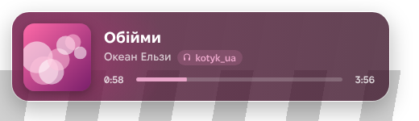
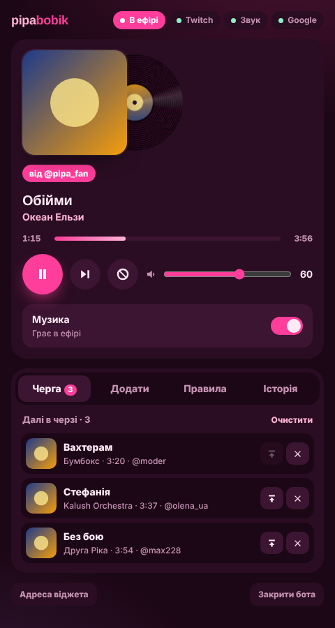

# 🎀 PipaBobik v2 (Rust + Tauri)

Музичний бот для Twitch на **YouTube Music**. Глядач пише `!трек назва пісні`, бот знаходить трек і вмикає його. Звук іде в трансляцію через OBS, а рожевий віджет із платівкою показує, що зараз грає.

Це друга версія [pipabobik](https://github.com/LoganBg23/pipabobik), переписана з Python на **Rust** і **Tauri**. Уміє все те саме: ті самі команди, застосунок, віджет, правила, фільтр і формат `config.toml`. Перша версія лишається окремим проєктом і нікуди не зникає.

<p align="center"></p>
<p align="center"></p>

## Що змінилося порівняно з v1

- **Один файл `PipaBobik.exe`** замість Python, `.venv` і десятка бібліотек. Нічого не треба встановлювати через pip.
- **Менше навантаження.** Сам бот займає близько 45 МБ пам'яті замість 150–250 МБ у v1 і майже не бере процесор, поки в чаті тиша (вікно застосунку — окремо).
- **Майстер налаштування у вікні** замість чорного вікна консолі. Там же кнопка «Перевірити» (замість `check.bat`).
- **Оновлення через GitHub Releases.** Кожна нова версія збирається автоматично, а кнопка «Оновити» в застосунку ставить її сама.
- **yt-dlp ставиться сам.** Якщо його немає, бот завантажить `yt-dlp.exe` у папку `bin\` і раз на тиждень оновлюватиме: YouTube часто щось змінює, а свіжий yt-dlp — головна умова, щоб треки не дропались.
- **Вхід Google береться з Firefox раз на 6 годин**, а не на кожен трек. Тому треки готуються швидше.
- **Кеш на 7 днів.** Фоновий плейлист (до 100 треків) і пошуки зберігаються в `data\cache`: музика з фону починає грати одразу, а плейлист тихо оновлюється у фоні раз на 6 годин. Повторне замовлення того самого треку знаходиться миттєво.

Під капотом: пошук іде напряму через API сайту music.youtube.com (як у ytmusicapi), аудіо отримує yt-dlp, грає mpv, чат працює через EventSub WebSocket, як і в v1.

---

## Команди

| Команда | Хто (за замовчуванням) | Що робить |
|---|---|---|
| `!трек назва` | усі | замовити трек (можна й посилання YouTube / YT Music) |
| `!шоце` | усі | що зараз грає, хто замовив, посилання |
| `!черга` | усі | наступні треки |
| `!нетой` | усі | прибрати свій останній трек з черги |
| `!музика` | усі | підказка: лише ті команди, які цій людині доступні |
| `!скіп` | модератори, помічники | пропустити трек; модератори можуть `!скіп назва` чи `!скіп 3` — прибрати конкретний трек |
| `!гучність 0-100` | модератори, помічники | гучність |
| `!перемотка 1:30` | модератори | перемотати на позицію; `+30` / `-15` — на секунди вперед чи назад |
| `!пауза` | модератори | пауза / продовжити |
| `!грай` | модератори | зняти з паузи (сама музика вмикається лише з трансляцією) |
| `!бантрек` | модератори | заборонити пісню назавжди: без назви — ту, що грає; `!бантрек назва` — названу |
| `!банвиконавця` | модератори | заборонити виконавця: без імені — того, хто грає зараз; `!банвиконавця ім'я` — названого. Його треки (і спільні, «feat.») зникають з черги й більше не грають |

Синоніми: `!sr`, `!songrequest`, `!request`, `!req`, `!track`, `!замовити`, `!ік`, `!nhtr`; `!скип`, `!skip`, `!next`; `!мотай`, `!seek`. Назви, ролі й ліміти змінюються в застосунку: ⚙ → «Команди й доступ» і «Ліміти замовлень».

---

## Встановлення (Windows 10/11, ~10 хвилин)

1. **Завантажте** архів `PipaBobik-windows-x64.zip` з [останнього випуску](https://github.com/LoganBg23/PipaBobik-v2-Rust/releases/latest) і розпакуйте, наприклад, у `C:\PipaBobik`. Шлях без кирилиці й пробілів допоможе уникнути проблем.
2. **Запустіть `install.bat`.** Він поставить mpv (програвач), Deno (потрібен yt-dlp) і yt-dlp, створить ярлик «pipabobik» на робочому столі й відкриє застосунок.
3. **Пройдіть майстер у застосунку:**
   - нік вашого каналу;
   - застосунок Twitch: майстер покаже, що натиснути на dev.twitch.tv, і дасть адресу для «OAuth Redirect URLs» з кнопкою «Копіювати»;
   - вхід у Google: увійдіть на [music.youtube.com](https://music.youtube.com) у **Firefox** (Chrome не віддає вхід іншим програмам);
   - що грати, коли черга порожня (`LM` — ваші вподобані).
4. Натисніть **«Увійти в Twitch»** і увійдіть тим акаунтом, від імені якого писатиме бот. Найзручніше — окремий акаунт «pipabobik» з модеркою на вашому каналі (`/mod pipabobik`).
5. Натисніть **«Перевірити»**: майстер перевірить Twitch, mpv, yt-dlp, Deno, вхід Google, пошук і отримання звуку.

### Перехід з v1
Скопіюйте з папки першої версії в папку `PipaBobik`:
- `config.toml` — усі налаштування, команди, ролі й ліміти підхопляться як є;
- папку `data\` — черга, бан-лист, лайки, фонові плейлисти, вхід у Twitch.

Потім у OBS замініть скрипт на `obs\pipabobik.lua` з v2 і вкажіть нову папку. Першу версію в цей час не запускайте: обидві використовують порт 17777.

---

## Підключення до OBS

### Автозапуск
1. OBS → **Інструменти → Скрипти** → **«+»** → оберіть `obs\pipabobik.lua`.
2. **Папка бота** → `C:\PipaBobik` (там, де лежить `PipaBobik.exe`).
3. **Коли запускати**: *разом з OBS* (музика вмикається з початком трансляції) або *разом з трансляцією*.

**Музика сама вмикається лише тоді, коли ви запускаєте трансляцію**, і стає на паузу після її кінця (черга зберігається). Ні бот, ні скрипт трансляцію не запускають. Щоб перевірити звук і віджет без ефіру, увімкніть перемикач **«Музика»** у застосунку — це тестовий режим; після перезапуску бота він вимикається. Коли ви закриваєте OBS, бот і застосунок закриваються теж.

### Звук
1. Замовте будь-який трек, щоб mpv заграв. У панелі задач з'явиться згорнуте вікно **pipabobik** — не закривайте його.
2. OBS → **Джерела → «+» → Захоплення звуку програми** → вікно **[mpv.exe]: pipabobik**, пріоритет — за **виконуваним файлом**.

### Віджет «зараз грає»
**Джерела → «+» → Браузер**, URL `http://localhost:17777/widget`, розмір **520 × 160**.

Напівпрозора картка бере колір з обкладинки кожного треку й плавно перефарбовується, коли трек змінюється. Поруч із виконавцем видно, хто замовив трек. Шрифт — український [Fixel](https://fixel.macpaw.com) від MacPaw (вбудований у бота). Анімуються лише прозорість і зсув, тож віджет майже не навантажує процесор.

Перемикач **«Рожевий віджет»** (застосунок → ⚙ → «OBS і віджет») робить віджет завжди фірмово-рожевим, не залежно від обкладинки.

Параметри адреси: `idle=hint` (підказка «Замов трек!», коли тиша), `scale=1.3` (масштаб), `demo=1` (демо-трек без бота; `demo=cycle` — демо змінює треки).

**Старий віджет** збережено: `http://localhost:17777/widget/classic` (розмір 680 × 220), файл — `web/legacy/widget-classic.html`.

### ⚠ Авторські права (DMCA)
Щоб музика була в ефірі, але не в записі: OBS → **Налаштування → Вивід → Розширений → Трансляція** → **Twitch VOD Track** (доріжка 2), а в розширених властивостях аудіо зніміть у `mpv.exe` галочку доріжки 2.

---

## Застосунок

Інтерфейс у стилі Windows 11, одне вузьке вікно:

- **Ефір**: що грає (картка підфарбовується в колір обкладинки), прогрес із перемоткою, пауза, «Далі», гучність, ♥ лайк у YouTube Music; у меню **⋯** — відкрити в YouTube Music, скопіювати посилання, заборонити трек чи виконавця. Нижче — рядок пошуку (**Ctrl+K**: назва або посилання), черга з часом, коли заграє кожен трек, історія і фоновий плейлист.
- **Стан угорі** («В ефірі», «Тестовий режим», «Тест без стріму»): натисніть, щоб увімкнути музику без трансляції — перевірити віджет — або вимкнути її.
- **⚙ Налаштування** (**Ctrl+,**) відкриваються в тому ж вікні, без окремих вікон: команди й доступ, текст «!музика», ліміти, помічники, фонові плейлисти, фільтри й бан-лист, повідомлення в чат, акаунти, OBS і віджет, оновлення, помилки. **Esc** — назад.
- **Верхня смуга** вікна напівпрозора, з кнопками «згорнути», «розгорнути» і «закрити»; на Windows 11 під нею системний ефект Mica. Тягніть вікно за смугу, подвійний клік — розгорнути.
- Клавіші: **пробіл** — пауза, **L** — лайк.

- **📌 Поверх усіх вікон** (кнопка вгорі): вікно pipabobik не ховається за грою чи OBS. Налаштування запам'ятовується.
- **Міні-плеєр** (кнопка поруч): застосунок згортається в маленьке вікно в правому нижньому куті екрана, завжди поверх інших. Там обкладинка, назва, прогрес, пауза, пропуск, ♥ і кнопка, що відкриває повне вікно. Міні-плеєр можна перетягнути куди завгодно — наступного разу він з'явиться там само.
- **Заборонити виконавця**: під назвою треку, що грає, кнопкою біля треків у черзі та історії, або вписати ім'я в ⚙ → «Фільтри й бан-лист». Розбанити — там само.
- **Закрили вікно** → pipabobik вимикається повністю (перед цим перепитає), черга зберігається.
- **Закрили OBS** → бот і вікно закриваються самі.
- **Повторний клік по ярлику** показує вже відкрите вікно.
- Посилання (YouTube, вхід у Twitch) відкриваються у звичайному браузері.
- Вікно працює на WebView2, який уже є у Windows 10/11. Якщо його немає, застосунок відкриється в Microsoft Edge.

### Оновлення
Бот раз на 6 годин перевіряє [випуски на GitHub](https://github.com/LoganBg23/PipaBobik-v2-Rust/releases). Коли є нова версія, зверху з'являється смуга зі списком змін і кнопкою **«Оновити»**, а архів одразу тихо завантажується з GitHub у фоні.

Після натискання «Оновити» відкривається окреме вікно **«Оновлення pipabobik»** з кроками: закриваю pipabobik → завантажую з GitHub (з відсотками) → перевіряю архів → закриваю OBS → резервна копія → замінюю файли → запускаю знову. Якщо OBS закривався, він відкриється сам, а скрипт OBS запустить бота; інакше запускаються бот і застосунок. Під час трансляції OBS не закривається — оновлюється лише бот. Якщо щось піде не так, файли повертаються з резервної копії, і далі працює попередня версія.

`config.toml`, `data\` і `bin\` оновлення не чіпає. Стара версія зберігається в `data\backups\` (3 останні), журнал — `data\update.log`.

### Видалення
Будь-яким із трьох способів:
- **Пуск → pipabobik → «Видалити pipabobik»**;
- ярлик **«Видалити pipabobik»** у папці бота;
- **Параметри → Програми → Установлені програми → pipabobik → Видалити**.

Ярлики в меню «Пуск» і запис у «Програмах» з'являються самі після першого запуску застосунку.

Видалення спершу перепитає, а потім запропонує **залишити налаштування й дані** (`config.toml` і `data\`: черга, бан-лист, лайки, вхід у Twitch), щоб наступне встановлення в цю папку їх підхопило. Далі воно зупиняє бота й застосунок і прибирає файли pipabobik, ярлики та запис у «Програмах». Якщо в папці лежать ваші власні файли, їх не буде зачеплено. Скрипт у OBS приберіть вручну (Інструменти → Скрипти → «−»). mpv, Deno і yt-dlp лишаються: їх можна видалити в «Програмах» окремо.

---

## Якщо щось не працює

- Відкрийте застосунок → вкладка **«Помилки»**: там усе, що пішло не так, з часом і подробицями. Кнопка «Скопіювати» збирає текст для розробника.
- Повний журнал — `data\pipabobik.<дата>.log` (зберігаються 3 останні дні).
- Майстер налаштування з кнопкою «Перевірити»: `http://localhost:17777/setup?key=…` (ключ — у `data\panel.key`).
- Треки не грають / «не вдалося отримати аудіо»: перевірте, що встановлено Deno, і видаліть `bin\yt-dlp.exe` — бот завантажить свіжий.
- Бот не бачить вхід Google: закрийте Firefox повністю й натисніть «Перезапустити» в застосунку.

---

## Для розробників

```
crates/core/      ядро (бібліотека pipabobik-core)
  src/config.rs     config.toml: типові значення, міграції v1, збереження з коментарями
  src/access.rs     ролі, дозволи команд, ліміти
  src/music.rs      пошук YouTube Music (InnerTube), yt-dlp, лайки
  src/player.rs     mpv + IPC (пауза, гучність, перемотка)
  src/jukebox.rs    черга, правила, цикл відтворення, попереднє отримання треків
  src/commands.rs   команди чату
  src/twitch.rs     OAuth, Helix, EventSub WebSocket
  src/rufilter.rs   фільтр російської музики (+ MusicBrainz)
  src/server.rs     axum: API, однакове з v1, і сторінки web/
  src/updater.rs    оновлення з GitHub Releases
  src/app.rs        усе разом, стеження за OBS
src-tauri/        PipaBobik.exe: вікно застосунку, режими --bot і --apply-update
web/              сторінки застосунку й віджета (ті самі, що в v1) + майстер setup.html
obs/              скрипт OBS
```

```sh
cargo test -p pipabobik-core          # тести ядра й API
cargo run -p pipabobik -- --bot -v    # бот без вікна, журнал у консолі
cargo run -p pipabobik                # вікно застосунку
```

На Linux для Tauri потрібні `libwebkit2gtk-4.1-dev`, `libssl-dev`, `pkg-config`. Збірку для Windows і випуски робить GitHub Actions (`.github/workflows/release.yml`) при кожному пуші в `main`.
